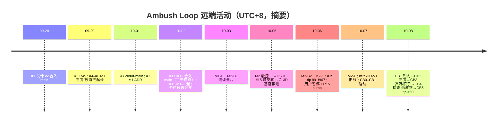
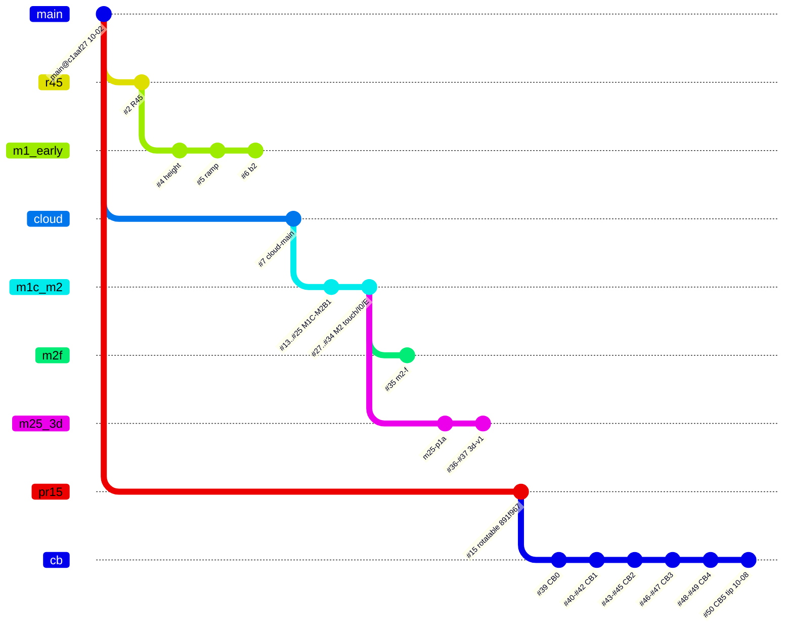
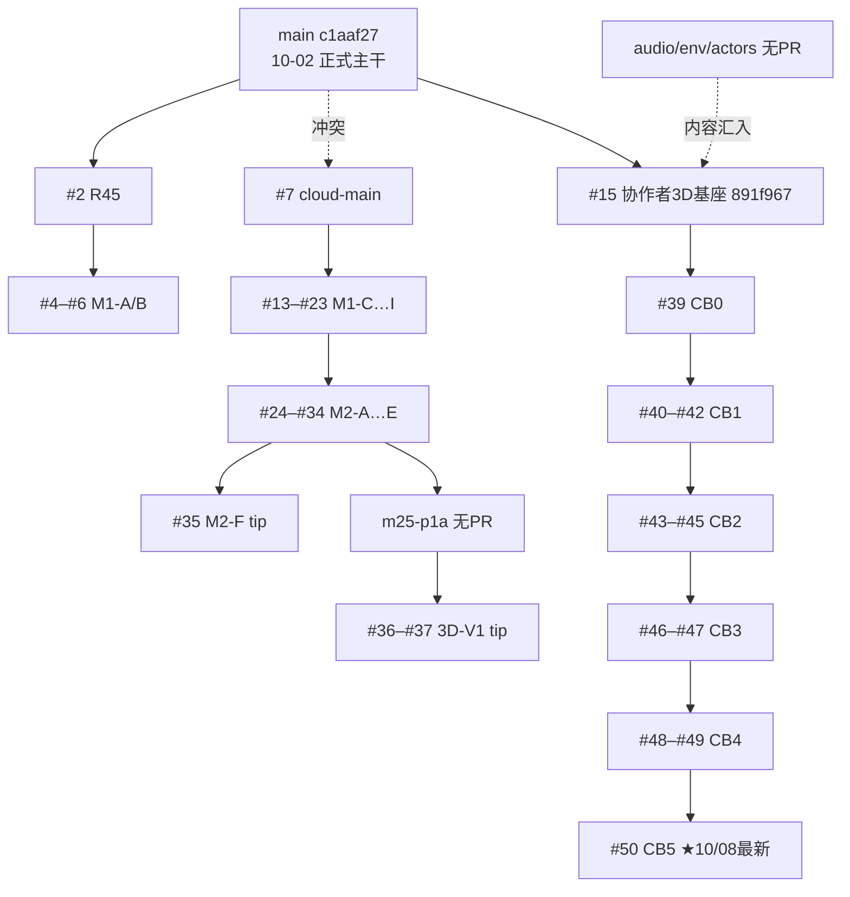

# Ambush Loop 仓库状态盘点（只读）

日期：2026-10-15（UTC+8）。仓库：`hailinsu-create/ambush-loop`。  
性质：**只读审计**；本文件不改玩法代码、不合并、不发布。数据来自远端分支/PR、`main` 与关键 tip 的 `git` 对照，以及 Notion《审核报告 2026-10-15》（39/80）。

方法说明：领先/落后相对 `origin/main`（`c1aaf27`，2026-10-02 17:34 UTC+8）。「相对 main 可干净合入」用 `git merge-tree` 对 **PR tip × main** 判定，不等于 GitHub「相对 base 分支」的 mergeable。链式关系优先取 PR `baseRefName`，无 PR 时用最近祖先 tip 推断。

---

## 0. 一句话结论

- **主干 `main` 停在 10-02**：仅合入设计 v2（#1）与寻路/审计（#11/#12）；之后约 47 个 open PR、50+ 功能/资产分支都未进主干。
- **用户认定的最新进度（10-08）在 CB 链 tip**：`codex/cb5-migration-closeout-20261008` / **PR #50**（相对 main **+397 / -0**）。这是协作者 3D 基座（PR #15 源 `891f967`）上的 CB0→CB5 迁移收口；本地切片与证据自称完成，**云 CI / 真机 / 陌生人 / M3 入口均未宣称通过**。
- **另有一条更长的 M1→M2 玩法链**（经 `cloud-main`，tip 约 #35/`m2-f`）与 CB **互不为祖先**，且对 main **冲突**；与 CB 并行还会重复「高度/触控/院子」主题。
- **文档与事实多处脱节**：`PLANNING_INDEX` 与 Notion 复核页仍写「#11/#12 未合并」，但二者已于 10-02 合并；Notion「高度规则未开始」也与未合并的 M1-C / CB2 代码不符。
- **Notion 审核 39/80：M0 未闭环，建议有条件继续**——与本盘点一致：先整理主干与 M0 证据，再决定是否把 CB tip 升为正式候选主干。

---

## 1. 全部分支

共 **56** 条远端分支（含 `main`）。时间均为 **UTC+8**。

### 1.1 总表（按最后提交时间）

| 分支 | 最后提交 UTC+8 | tip | vs main | PR | 里程碑 | 备注 |
| --- | --- | ---: | --- | --- | --- | --- |
| `docs/design-v2-roadmap` | 09-28 23:48 | `9bb93d23` | +0/-6 | #1 MERGED | docs/M0 规划 | 已合入；分支落后于 tip |
| `codex/r45-sweep-first-tip` | 09-29 08:04 | `4a2aa42b` | +1/-5 | #2 OPEN | R45→M1 | 与 main 冲突 |
| `codex/m1-yard-height-prototype` | 09-29 18:50 | `00bf7066` | +2/-5 | #4 OPEN | M1-A | 叠在 #2 |
| `codex/m1-ramp-pathfinding` | 09-29 20:17 | `6402deab` | +3/-5 | #5 OPEN | M1-B1 | 叠在 #4 |
| `codex/m1-b2-playable-yard` | 10-01 00:11 | `2205b3f0` | +5/-5 | #6 OPEN | M1-B2 | 叠在 #5 |
| `docs/m1-yard-adr` | 10-01 02:36 | `0124d36a` | +22/-5 | #3 OPEN | M1 文档 | 对 main 冲突 |
| `codex/cloud-main` | 10-01 17:52 | `e3faeb58` | +54/-5 | #7 OPEN | 云基建 | M1-C+ 链的实际底座；对 main 冲突 |
| `codex/paperroute-cloud-exit-20261001` | 10-02 02:46 | `c5d3f794` | +68/-5 | #8 OPEN | 云基建 | 叠 `cloud-main` |
| `codex/local-device-preflight` | 10-02 03:19 | `8e31d88e` | +55/-5 | #10 OPEN | M0/设备 | 叠 `cloud-main` |
| `lning` | 10-02 16:18 | `989f8ebb` | +0/-4 | #11 MERGED | 工程 | 已合；分支指针旧 |
| `lning-audit` | 10-02 16:54 | `4af59e18` | +0/-3 | #12 MERGED | 文档 | 已合；分支指针旧 |
| **`main`** | **10-02 17:34** | **`c1aaf27c`** | **+0/-0** | — | 主干 | 最新正式主干 |
| `codex/m1-c-height-los` | 10-02 17:27 | `e2550b73` | +55/-5 | #13 OPEN | M1-C1 | 叠 `cloud-main` |
| `codex/m1-c2-fire-height` | 10-02 18:32 | `e55a5216` | +56/-5 | #16 OPEN | M1-C2 | 叠 #13 |
| `docs/asset-upgrade-20261002` | 10-02 18:12 | `d69251be` | +3/-0 | #14 OPEN | 资产规划 | 对 main 干净 |
| `wip/asset-actors-handoff-20261002` | 10-02 20:44 | `a164aa0d` | +10/-0 | 无 | 资产 | 角色交接；无 PR |
| `codex/m1-c3-selected-coverage` | 10-02 20:47 | `1de462ae` | +57/-5 | #17 OPEN | M1-C3 | 叠 #16 |
| `feat/audio-v2-candidate-20261002` | 10-02 23:49 | `355ea892` | +25/-0 | 无 | 资产/音频 | 候选；内容多已进 #15/CB |
| `feat/environment-dot-candidate-20261002` | 10-03 01:25 | `9c06f04c` | +31/-0 | 无 | 资产/环境 | 同上 |
| `codex/m1-d-plan-retry` | 10-03 02:17 | `be4c659e` | +58/-5 | #18 OPEN | M1-D | 叠 #17 |
| `fix/asset-actors-dot-20261002` | 10-03 02:35 | `ebedb829` | +21/-0 | 无 | 资产/角色 | 无 PR |
| `codex/m1-e-resource-budget` | 10-03 11:13 | `720511ed` | +59/-5 | #19 OPEN | M1-E | 叠 #18 |
| `codex/m1-f-timing-causality` | 10-03 11:45 | `2010829b` | +60/-5 | #20 OPEN | M1-F | 叠 #19 |
| `codex/m1-g-tactical-solutions` | 10-03 12:13 | `da106385` | +61/-5 | #21 OPEN | M1-G | 叠 #20 |
| `codex/m1-h-end-to-end` | 10-03 12:34 | `e2c98d21` | +62/-5 | #22 OPEN | M1-H | 叠 #21 |
| `codex/m1-i-visual-evidence` | 10-03 13:20 | `8bc9a4f5` | +63/-5 | #23 OPEN | M1-I | 叠 #22 |
| `codex/m2-a-clear-tactical-ui` | 10-03 21:14 | `26528ddc` | +64/-5 | #24 OPEN | M2-A | 叠 #23 |
| `codex/m2-b1-explicit-supplies` | 10-03 22:12 | `42ba583e` | +65/-5 | #25 OPEN | M2-B1 | 叠 #24 |
| `codex/local-continuation-plan` | 10-03 22:35 | `8c09d4cf` | +83/-5 | #9 OPEN | 规划 | 叠 `cloud-main` |
| `codex/m2-t1-touch-intent` | 10-05 17:52 | `e1bc3189` | +66/-5 | #27 OPEN | M2-T1 | 叠 #25；非 draft |
| `codex/m2-t2-canceled-touch` | 10-05 18:04 | `8728081b` | +67/-5 | #28 OPEN | M2-T2 | 叠 #27 |
| `codex/m2-t1-plan-20261005` | 10-05 19:31 | `c67f54b8` | +7/-0 | #26 OPEN | M2 规划 | 对 main；非 draft |
| `codex/m2-i0-yard-3d-integration` | 10-06 00:43 | `1e9e7840` | +69/-5 | #29 OPEN | M2-I0 | 叠 #28 |
| `codex/m2-b2-single-contact` | 10-06 03:25 | `54e4c9a8` | +74/-5 | #31 OPEN | M2-B2 | 叠 #30；对 base 亦 DIRTY |
| `codex/m2-d1-preparation-checkpoint` | 10-06 03:26 | `3d46d88c` | +77/-5 | #32 OPEN | M2-D1 | 叠 #31 |
| `codex/m2-t3-touch-targets` | 10-06 03:57 | `c68328c7` | +72/-5 | #30 OPEN | M2-T3 | 叠 #29 |
| `codex/m2-c-team-permission` | 10-06 03:58 | `379d7ea4` | +79/-5 | #33 OPEN | M2-C | 叠 #32 |
| `codex/m2-e-yard-presentation` | 10-06 04:29 | `f9c5d92b` | +81/-5 | #34 OPEN | M2-E | 叠 #33；其后分叉 |
| `feat/rotatable-yard-a0-20261002` | 10-06 05:24 | `891f967e` | +353/-0 | #15 OPEN | 3D 基座/资产 | **CB 链祖先**；对 main 干净 |
| `codex/m2-f-operable-guide` | 10-07 04:19 | `28cecd27` | +101/-5 | #35 OPEN | M2-F | 玩法链 tip 之一 |
| `codex/m25-p1a-tactical-data` | 10-07 12:33 | `2177215b` | +131/-5 | 无 | M2.5? | 自 `m2-e` 分叉；**不含** `m2-f` |
| `codex/3d-visual-upgrade-plan-20261007` | 10-07 13:00 | `f2d329d4` | +132/-5 | #36 OPEN | 3D 规划 | 叠 m25 |
| `codex/3d-v1-yard-look-20261007` | 10-07 15:34 | `a6c09623` | +139/-5 | #37 OPEN | 3D V1 | 叠 #36；**旧 3D 线 tip** |
| `codex/cb0-collaborator-base-20261007` | 10-07 22:18 | `c717c88c` | +356/-0 | #39 OPEN | CB0 | 叠 #15 |
| `codex/cb1-north-hud-20261007` | 10-07 22:41 | `edeeb079` | +358/-0 | #40 OPEN | CB1 | 叠 #39 |
| `docs/collaborator-base-plan-20261007` | 10-07 22:42 | `b9d872b3` | +3/-0 | #38 OPEN | CB 规划 | 文档；对 main 干净 |
| `codex/cb1-touch-intent-20261007` | 10-07 23:36 | `0232dc03` | +360/-0 | #41 OPEN | CB1 | 叠 #40 |
| `codex/cb1-facing-20261008` | 10-08 00:13 | `00bf32e0` | +362/-0 | #42 OPEN | CB1 | 叠 #41 |
| `codex/cb2-height-20261008` | 10-08 01:12 | `6eb17d96` | +367/-0 | #43 OPEN | CB2 | 叠 #42 |
| `codex/cb2-height-world-20261008` | 10-08 01:54 | `79e86a5f` | +371/-0 | #44 OPEN | CB2 | 叠 #43 |
| `codex/cb2-tactical-status-20261008` | 10-08 02:02 | `0522c938` | +373/-0 | #45 OPEN | CB2 | 叠 #44 |
| `codex/cb3-ammo-20261008` | 10-08 02:16 | `d38ed4a1` | +375/-0 | #46 OPEN | CB3 | 叠 #45 |
| `codex/cb3-yard-20261008` | 10-08 13:38 | `481b33a4` | +384/-0 | #47 OPEN | CB3 | 叠 #46 |
| `codex/cb4-world-checkpoint-20261008` | 10-08 14:04 | `963c7775` | +386/-0 | #48 OPEN | CB4 | 叠 #47 |
| `codex/cb4-teaching-20261008` | 10-08 14:18 | `ae9c526a` | +391/-0 | #49 OPEN | CB4 | 叠 #48 |
| **`codex/cb5-migration-closeout-20261008`** | **10-08 15:06** | **`7879040c`** | **+397/-0** | **#50 OPEN** | **CB5** | **10/08 最新工作线 tip** |

### 1.2 工作线归类（依赖）

| 线 | 链 | tip / PR | 与 main |
| --- | --- | --- | --- |
| **A. 正式主干** | `main` ← #1 ← #11 ← #12 | `c1aaf27` | 基准 |
| **B. R45→M1 早期** | #2→#4→#5→#6 | `m1-b2` | 冲突；落后 |
| **C. 云底座 + M1-C…M2-F** | #7(`cloud-main`)→#13…#25→#27…#35 | `m2-f` / #35 | **对 main 冲突**；含高度/触控/院子玩法 |
| **C′. m2-e 分叉 3D 旧线** | `m2-e`→`m25-p1a`(无PR)→#36→#37 | `3d-v1` / #37 | 冲突；**不含 m2-f** |
| **D. 协作者 3D + CB（10/08）** | #15(`891f967`)→#39…#50 | **`cb5` / #50** | tip 对 main **可 merge-tree**；+397 |
| **E. 资产候选（无 PR）** | audio / environment / actors / wip | 各自 tip | 大体被 #15/CB 吸收 |
| **F. 文档旁路** | #3, #14, #26, #38 | — | #3 冲突；其余干净 |

旁支：`#8/#9/#10` 叠在 `cloud-main`（云退出/本地计划/设备预检），不接入 CB。

### 1.3 时间线与依赖（Mermaid）

简化依赖（推荐阅读）：

---

## 2. 全部 PR（#1–#50）

共 50 个 PR：3 MERGED（#1/#11/#12），**47 OPEN**（绝大多数 draft；#2/#26/#27 为非 draft）。

### 2.1 已合并

| PR | 标题摘要 | 合并日 UTC+8 | 说明 |
| --- | --- | --- | --- |
| #1 | 设计 v2 与规划交接 | 09-28 | 设计基线入库 |
| #11 | 寻路 score 查找优化 | 10-02 | 已在 main |
| #12 | 代码审计文档与截图 | 10-02 | 已在 main |

### 2.2 Open PR 摘要（按线）

**R / M1 早期（#2–#6）**  
教会首次清扫；院子高度数据契约；坡道 A\*；可玩高台院子。链短但相对 main 已冲突。

**云与设备（#7–#10）**  
Codex Cloud 准备、PaperRoute 可复现、本地续开发/设备门、只读 Android 预检。底座已偏离 main。

**M1-C…M2-F 玩法大链（#13–#35，base 串在 cloud 上）**  
高度 LOS→开火→覆盖；冻结/重试；资源预算；时机因果；战术两案；端到端/视觉门；简化 HUD；明示补给；触控预览/取消/热区；院子 3D 集成；单接触；准备检查点；开火许可；演出；可操作引导。  
→ tip **#35**。整链对 **main 冲突**。#31 对自身 base 亦 DIRTY。

**资产 / 3D 基座（#14/#15）**  
资产升级计划；**可旋转六关 3D、角色动作、只读回放**（#15，+353，CB 祖先）。

**M2 触控规划（#26）**  
文档，对 main 干净。

**旧 3D 升级线（#36–#37）**  
叠在无 PR 的 `m25-p1a` 上；与 #35 分叉；对 main 冲突。

**CB 迁移线（#38–#50）**  
#38 文档；#39 起完整协作者基座；CB1 HUD/触控/朝向；CB2 高度世界与战术条；CB3 弹药与院子双解；CB4 检查点与教学；**#50 CB5 六关收口与云交接**。  
→ tip **#50**。各 tip 对 **main 的 merge-tree 为干净**（因 #15 基于后 #12 的 main），但体积巨大（含大量证据 PNG）。

### 2.3 冲突、重复与建议合并顺序

**互相冲突 / 不可直接串合**

- **线 C（#7+#13…#35）与线 D（#15+#39…#50）**：互不为祖先；主题重叠（高度、触控、院子、3D）。不可「两条都按序合进 main」。
- **线 C′（#36–#37）** 与 **#35**：自 `m2-e` 分叉，重复 3D 叙事但实现分叉。
- **#2–#6** 与 main / 与后继大链均过时。

**重复主题（需择一保留）**

| 主题 | 玩法链 C | CB 链 D | 建议 |
| --- | --- | --- | --- |
| 高度 | M1-C1…C3、部分 M2 | CB2 | **以 CB2 为续作候选**（叠在真实 3D 基座）；C 链作对照，勿双合 |
| 触控确认 | M2-T1…T3 | CB1 | 同上，CB1 已在 3D 触控上验收叙述 |
| 院子双解/预算 | M1-E…G、M2-B2 | CB3 | 同上 |
| 准备检查点/教学 | M2-D1、M2-F | CB4 | 同上 |
| 3D 呈现 | M2-I0/E、#36–#37 | #15+CB | **#15/CB 为资产与场景真源** |

**建议合并顺序（整理主干，非立即执行）**

1. **先不合并任何大体量功能 PR**，直到 M0 真机退出门勾选（与 Notion 一致）。
2. 文档修正：更新 `PLANNING_INDEX`（#11/#12 已合；指向本审计与 CB5 交接）——单独 docs PR。
3. 若选定 **CB 为唯一续作线**：只保留 **#50 tip**（或 squash/merge 后的单一集成分支）；关闭/归档 #2–#10、#13–#37 中被取代者；#14/#26/#38 择要合文档后关。
4. 若选定 **玩法链 C**：需先把 `cloud-main` **变基到当前 main**，再从 #13 起重叠冲突解决——成本高于延续 CB，且会丢失 #15 大体量资产除非再迁一次。
5. **禁止**「先合 #15 再合 #35」或反之而不做冲突审计。

### 2.4 10/08 最新工作线完整状态

| 项 | 状态 |
| --- | --- |
| 分支 | `codex/cb5-migration-closeout-20261008` |
| tip | `7879040c`（2026-10-08 15:06 UTC+8） |
| PR | [#50](https://github.com/hailinsu-create/ambush-loop/pull/50) draft OPEN；base=`cb4-teaching` |
| vs main | **+397 / -0**；merge-tree 对 main 干净 |
| 祖先 | `main` → #15 `891f967` → CB0…CB4 → CB5 |
| 自称已完成 | CB0–CB4 核心迁移切片；CB5 本地六关矩阵 / 受影响专项 / QA PCK 资源门；交接文档 `AMBUSH_CB5_CLOUD_HANDOVER_20261008.md`；冻结码叙述 `81d46f3` |
| 明确未宣称 | 云 Actions 通过、真机长局、陌生人盲测、新 GPT 评审、整体迁移/M3 入口、发行卫生 |
| tip 上 PLANNING_INDEX | 已改为 2026-10-08，入口指向 CB5 云交接（**main 上仍是 10-02 旧索引**） |
| 与 Notion 39/80 | Notion 主要评的是 **main 文档态**；未把 CB tip 当已验收成品。H1「M0 未闭环却已推进」对 CB 扩张仍然成立 |

---

## 3. 资产盘点

### 3.1 `main` 上已有（约 293 个媒体类文件）

| 区域 | 规模（约） | 说明 |
| --- | --- | --- |
| `ambush_loop/docs/eval_*` | ~230 PNG + 9 WAV | 历史评测截图/音，非运行时主资产 |
| `ambush_loop/art/look` | 13 PNG | 2D look 样张 |
| `ambush_loop/ArtSource/*.glb` + iso/turnaround | 14 GLB + 配套 PNG | PaperRoute 程序道具；README 写明 look stream |
| `ambush_loop/icon.svg` | 1 | 图标 |
| `.cursor/docs/evidence` | 7 PNG | M0 等证据 |

**main 无**：`art/environment_v2`、`art/audio_v2`、`art/v2`、`ui/fonts` 打包中文字体、大体量 GLB 场景包。

### 3.2 未合并分支上的增量（相对 main）

| 分支 | 仅该侧资产约数 | 构成摘要 |
| --- | --- | ---: |
| **#15 / CB0 / CB5** | **~2384–2390** | `.cursor/docs/evidence` 大量 PNG（~2170+）；`art/environment_v2` ~83；`art/v2` ~81；`art/audio_v2` ~45 wav；GLB ~155；字体 ttf+woff2 |
| `feat/environment-dot-candidate` | ~201 | 环境 GLB/PNG 候选 |
| `feat/audio-v2-candidate` | ~123 | 音频 WAV + 部分 GLB |
| `fix/asset-actors-dot` | ~283 | 角色相关 PNG/GLB |
| `wip/asset-actors-handoff` | ~88 | 交接用 |
| M2-I0 / M2-F / m25 | ~15 | 少量 GLB/PNG |
| M1-I | ~5 | 视觉门截图 |
| 3d-v1 | ~18 | 略多于 M2 |

结论：**运行时级 3D/音频/字体几乎全在 #15→CB 线**；main 仍是「2D + 少量 ArtSource 道具」基线。

### 3.3 来源与许可记录

| 资产 | 记录位置 | 许可/来源 |
| --- | --- | --- |
| 仓库血统 | 多分支 `SOURCE_PROVENANCE.md` | 源自 `hailinsu-create/new` PR #64 @ `ab2076f`；未带历史 APK |
| ArtSource 道具 | `ambush_loop/ArtSource/README.md` | 自研 Blender 脚本；look 未全部进可玩场景 |
| audio_v2 | `feat/audio-v2-candidate` 下 `ArtSource/audio_v2/LICENSE.txt` | **CC0-1.0**（新生成 WAV）；脚本 MIT |
| audio_v2 在 CB5 | 有 `ambush_loop/art/audio_v2/*.wav` | **未见** 同路径 `ArtSource/audio_v2/LICENSE.txt`（许可文件未随运行时目录完整迁入 tip） |
| environment_v2 | `OWNERSHIP_AND_PLAN.md` 等 | 声称原创程序几何；无第三方下载 |
| 字体（CB/#15） | `ambush_loop/ui/fonts/README.md` | Noto CJK SC → **OFL 1.1**；DejaVu Sans → Bitstream/DejaVu 声明 |
| PR15 致谢/credits | `.cursor/docs/AMBUSH_PR15_CREDITS_*.md` | UI 致谢流程证据，非素材许可证台账 |
| main 整体 | 无统一 `THIRD_PARTY_NOTICES` / 发行许可台账 | 符合设计 v2「M5 才交许可台账」——当前缺口 |

---

## 4. 开发进度对照

### 4.1 里程碑状态（设计 v2 + 实际分支）

| 里程碑 | 设计退出门 | 实际（2026-10-15） | 判定 |
| --- | --- | --- | --- |
| **M0** | 隔离/构建；真机 Back/后台；可重复 | 隔离冒烟与调试 APK 有证据；**Back 修复包真机、后台、覆盖升级、陌生人首局未闭环**；无发行签名/CI | **进行中 / 未闭环** |
| **M1** | 院子低保真：高点、资源、两案、预览=模拟 | 代码在 **未合并** 的 C 链与 **CB2/CB3**；main 无高度结算；盲测未做 | **进行中（未进主干、未体验验收）** |
| **M2** | 新风格、HUD、音效、续玩、5 人盲测 | #15/CB 已大幅推进 3D/HUD/音频；M2-F 在另一线；**5 人盲测无** | **进行中（表现超前于 M0/盲测）** |
| **CB0–CB5** | 协作者基座迁移（非 v2 原表） | tip #50 自称本地收口；云/设备/GPT 未过 | **本地切片进行中→待云验收**；**非正式 M3** |
| **M3** | 六关战术改造 + 战役盲测 | CB5 有六关矩阵叙述，但明确 **未宣称 M3 入口** | **未开始（正式意义上）** |
| **M4** | 性能/兼容/存档迁移/升级 | 未建；Notion 建议前移为 M2.5 | **未开始** |
| **M5** | 签名 APK、许可台账、发行说明 | 未开始 | **未开始** |
| **R45** | 搜刮提示验收后归 M1 | #2 仍 open，对 main 冲突 | **在制未验收** |

### 4.2 Notion《审核报告 2026-10-15》要点

- **总分 39/80（均 4.9）**；建议「有条件继续：先闭环 M0，再扩张 M1」。
- 高优先级：M0 真机未闭环（H1）；高度规则缺失（H2）；无发行签名/targetSdk 工具链（H3）；存档迁移排太晚（H4）。
- 中：无 CI；**误称 #11/#12 未合并**；视觉与玩法并行风险等。

### 4.3 文档 vs 实际不一致

| 文档说法 | 实际 |
| --- | --- |
| `PLANNING_INDEX.md`（main）：#11/#12「均未合并」 | **已于 10-02 合并**进 main |
| Notion 复核页 / 审核报告：同上 | 同上，**过时** |
| Notion：高度 ADR「还没开始」、cover_slot 无高度 | **未进 main** 属实；但 **#13–#17 与 CB2 已有大量高度相关提交**（未合并≠未开始） |
| main 索引日期停在 10-02，接手顺序仍写「先 R45 再 M1 院子」 | tip CB5 索引已改写为 CB 云交接入口；**两套真相** |
| M0 报告写「已验证」多项 | 与「未闭环」并列存在；Notion 批评退出门不严——**两边都对，但 main 索引未强调未闭环优先** |
| 设计 v2「先 M1 玩法、后 M2 视觉」 | 实际 **#15/CB 视觉/3D 基座已远超 main 玩法合入**；玩法改进在分叉链上 |

---

## 5. 建议

### 5.1 主干整理

1. **宣布单一续作线**：推荐 **CB tip（#50）** 为「最新工程候选」；玩法大链 C / 3D 旧线 C′ 标为 **归档对照，不合并**。
2. **main 暂保持冻结玩法合入**，只允许：本审计、索引勘误、M0 真机/CI/签名相关最小 PR。
3. **关闭或 Draft 归档**：#2–#10、#13–#37（保留链接与 tip SHA 在索引中）；无 PR 的 audio/env/actors 标明「已吸收进 #15」后停更。
4. **#15 与 #39–#50**：不要逐个合 12 个堆叠 PR；需要合入时用 **单一集成合并（#50 tip → main）** 或新建 `integration/cb5-…` 再开一个 PR，并附：隔离冒烟退出码、PCK/资源门、已知红灯清单。
5. **合入前硬门槛**：Notion M0 退出门至少 Back/后台/覆盖升级之一有真机证据 + `run_isolated_test` 绿；否则 CB 只作候选分支。

### 5.2 下一步顺序（与 Notion 对齐，略加仓库现实）

1. **文档勘误**：`PLANNING_INDEX` 修正 #11/#12；增加「有效工程候选 = CB5 tip」与「main = 10-02 基线」双轨说明。  
2. **M0 闭环**：adb 安装、Back、后台、「不保留活动」、0.6.28→新包升级。  
3. **最小 CI**：Godot 4.7.2 + `run_isolated_test.sh` 挂到 main（随后挂到候选 tip）。  
4. **在 CB tip 上核对**：高度/弹药/双解是否满足设计 v2 反例；缺则只开 CB 后续小 PR，不回 C 链。  
5. **陌生人院子灰盒** 通过后再谈 M3/其余五关职责改造。

### 5.3 明确不建议

- 不把 #35 与 #50 强行双向合并。  
- 不在 M0 未闭环时把 CB 默认视为「已可发行/已完成 M2」。  
- 不删除历史分支（保留 SHA）；用索引标注 superseded。

---

## 6. 数据来源与局限

- GitHub：`origin` 全部分支与 PR #1–#50（2026-10-15 拉取）。  
- Notion：https://app.notion.com/p/3fab407a692a80e08680f649d2b35aa9 （审核报告）；父页「Ambush Loop 项目复核」。  
- 未重跑 Godot 冒烟/真机；CB 自称退出码以分支文档为准，**本审计未复验**。  
- `chatgpt:unavailable`（本环境无网页 GPT 桥）；未代写 approve。

---

## 7. 变更说明

本文件为只读盘点产物，单独分支提交；**不更新** `PLANNING_INDEX.md`（留给后续显式 docs 切片），以免把「索引勘误」与「审计入库」混在同一未评审提交中。
